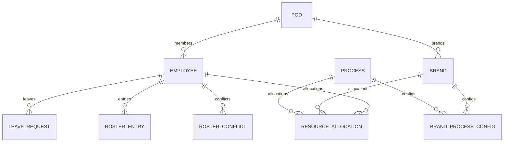

# Smart Roster Management System

A production-ready, full-stack **Smart Roster Management System** tailored for D2C customer experience & operations companies managing multi-brand, multi-process staffing pods.

---

## Key Features

1. **Deterministic Scheduling Engine (`scheduler/engine.py`):**
   - Staggers weekly offs for shared-brand staffing pools to preserve minimum required headcount (`min_daily_staff`).
   - Hard locks approved leaves, comp-offs, and public holidays.
   - Enforces a rolling maximum of 6 consecutive working days per employee.
   - For single-resource 365-day brands, honors weekly off while flagging `CRITICAL COVERAGE_GAP` and suggesting pod-level cross-trained backups.
   - Full automated re-validation whenever leaves are booked or manual cell overrides occur.

2. **5 Specialized Operational Views:**
   - **Company-Wide View:** Complete interactive employee-by-date matrix across all 4 pods with pod filters and conflict badges.
   - **Pod-Wise View:** Pod-grouped schedule with Pod Lead indicators and daily utilization statistics.
   - **Brand-Wise View:** Client coverage dashboard showing operating rule, assigned personnel, and daily green/red coverage bars.
   - **Process-Wise View:** Real-time staffing count vs. minimum required headcount for CS, ACC, Retention, and NDR Management.
   - **Employee-Wise View:** Monthly employee calendar breakdown of Working Days, Weekly Offs, Public Holidays, and Approved Leaves.

3. **Interactive Operations Tools:**
   - Quick cell click popover to change status (`WORKING`, `WEEKLY_OFF`, `PLANNED_LEAVE`, `COMP_OFF`) or reassign brand/process.
   - Live **Conflicts & Resolutions Panel** with 1-click **"Apply Suggested Backup"** resolution.
   - Comprehensive **Configuration & Operations Modal** for adding/managing Employees, Brands, Process Rules, and Resource Allocations without touching code.
   - Pre-seeded with 4 Pods, 32 Employees, 20 Brands, 4 Processes, Public Holidays, and Approved Leaves.

---

## Architecture & Relational Schema



### Relational Models
1. **Pod:** `name`, `lead` (FK Employee)
2. **Employee:** `name`, `email`, `pod`, `is_pod_lead`, `max_working_days_per_week` (6), `preferred_weekly_off` (0-6 Mon-Sun)
3. **Brand:** `name`, `pod`, `is_active`
4. **Process:** `name` (Customer Support, Abandoned Cart Conversions, Retention, NDR Management)
5. **BrandProcessConfig:** `brand`, `process`, `operating_rule` (`365_DAYS`, `EXCEPT_HOLIDAYS`, `NO_SUNDAYS_OR_HOLIDAYS`), `min_daily_staff`, `day_of_week_overrides`
6. **ResourceAllocation:** `employee`, `brand`, `process`, `role_type` (`PRIMARY`, `SHARED`, `BACKUP`)
7. **PublicHoliday:** `date`, `name`, `is_mandatory`
8. **LeaveRequest:** `employee`, `start_date`, `end_date`, `leave_type`, `status`
9. **RosterEntry:** `date`, `employee`, `brand`, `process`, `status`, `is_manual_override`
10. **RosterConflict:** `month`, `date`, `severity`, `conflict_type`, `brand`, `process`, `employee`, `description`, `suggested_resolution`, `resolved`

---

## Quickstart Guide

### 1. Backend Setup (Django + DRF)

```bash
cd backend

# Create & activate a virtualenv (optional)
python -m venv venv
# Windows:
venv\Scripts\activate
# Linux/Mac:
source venv/bin/activate

# Install dependencies
pip install -r requirements.txt

# Run migrations
python manage.py migrate

# Seed 4 Pods, 32 Employees, 20 Brands, and Constraints
python manage.py seed_data

# Run unit tests
python manage.py test scheduler

# Start the Django development server (http://localhost:8000)
python manage.py runserver 0.0.0.0:8000
```

### 2. Frontend Setup (React + Vite + Tailwind CSS)

```bash
cd frontend

# Install Node dependencies
npm install

# Start Vite dev server with proxy to backend (http://localhost:5173)
npm run dev
```

Open your browser to `http://localhost:5173`.

---

##  Verification & Simulation Walkthrough

1. Click **"Generate Roster"** in the top bar for November 2026.
2. Notice the live conflict badge updating with detected Critical coverage gaps (single-resource 365-day brands on weekly off) and soft warnings.
3. Switch across the 5 views:
   - **Company-Wide:** Filter by Alpha, Beta, Gamma, or Delta Pod.
   - **Brand-Wise:** Observe FreshGlow Skincare showing red coverage blocks on Priya Nair's weekly off days.
   - **Process-Wise:** View daily CS, ACC, Retention, and NDR headcount.
   - **Employee-Wise:** Select any employee to see their monthly breakdown.
4. Click **"Add Leave"** to simulate an emergency leave for a single-resource brand owner (e.g., Rahul Verma on UrbanFit Apparel) and observe the instantaneous conflict calculation with suggested cross-trained pod backup recommendations.
5. Click **"Config"** to add custom brands, assign multi-employee allocations, or change operating rules directly from the dashboard.
